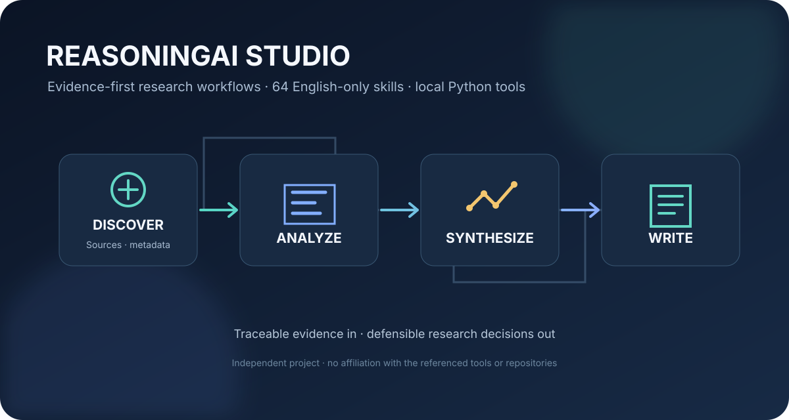

# Reasoningai.studio

**Turn research questions into defensible findings—with evidence you can trace at every step.**

An evidence-first research toolkit for AI agents and human researchers: 64 focused skills, 12 reusable prompts, practical research templates, and local Python utilities for more transparent, reproducible research.


## Research workflows, not generic prompts

ReasoningAI Studio brings research tasks into one coherent, inspectable workflow. Its 64 standalone English-language skills cover the research lifecycle—from framing a question and finding literature to evaluating evidence, designing experiments, auditing machine-learning results, writing a paper, and responding to peer review.

The collection combines 34 original ReasoningAI workflows with 30 clearly namespaced ResearchForge Skills. The imported contribution keeps its own attribution and licensing; see [NOTICE.md](NOTICE.md) before reusing material.



## What's included

- **64 portable agent skills** with defined inputs, task-specific steps, concrete outputs, and research-integrity boundaries.
- **12 copy-ready English prompts** for literature synthesis, paper reading, methods review, claim auditing, reproducibility, statistics, and research communication.
- **Local Python utilities** for scholarly metadata search, DOI lookup, BibTeX checks, screening ledgers, PRISMA-style count summaries, claim-evidence audits, SHA-256 manifests, and common secret-pattern scans.
- **Research scripts and templates** for bibliography verification, dataset auditing, reproducibility preflight, research protocols, evidence matrices, experiment plans, and claim-evidence tracking.
- **Synthetic examples and automated tests** so you can inspect the expected inputs and validate the local tools without using private research data.

Browse the [complete skill catalog](docs/skill-catalog.md), [architecture](docs/skill-architecture.md), and [research ecosystem references](docs/research-ecosystem.md).

## Quick start

Requires Python 3.10 or newer. The local utilities use the Python standard library; no runtime third-party packages are required.

```bash
python -m pip install .
python -m reasoningai doctor
python -m reasoningai search "retrieval augmented generation" --provider openalex --limit 10
```

To use a skill, open `skills/<skill-name>/SKILL.md` in a compatible AI assistant. Start with the [skill catalog](docs/skill-catalog.md) and load only the workflow relevant to the task.

## Local research utilities

```bash
# Audit a clean illustrative BibTeX file
python -m reasoningai bib-audit examples/references.bib

# Demonstrate duplicate-DOI detection (this fixture is expected to report an issue)
python -m reasoningai bib-audit examples/references-with-duplicates.bib

# Verify DOI metadata against Crossref; --offline prevents network requests
python scripts/verify_bibliography.py examples/researchforge-illustrative-references.bib --offline

# Audit a CSV or JSONL dataset for duplicate rows and exact-text split leakage
python scripts/audit_dataset.py examples/researchforge-synthetic-dataset.csv --text-column text --label-column label --split-column split

# Run a heuristic reproducibility preflight on a project folder
python scripts/check_reproducibility.py .

# Validate all skill files
python scripts/validate_skills.py
```

## Research principles

- **Evidence before rhetoric:** connect substantive claims to verifiable sources, data, or reported results.
- **Clarity without distortion:** write with confidence while preserving negative findings, contradictory evidence, uncertainty, and material limitations.
- **Reproducibility by design:** record search strategies, screening decisions, data provenance, configurations, and hashes.
- **Human accountability:** AI-generated suggestions are not peer review, statistical validation, ethics approval, or independent replication.
- **Privacy-aware by default:** local tools do not upload manuscripts or datasets to a ReasoningAI server. Network requests occur only when a user explicitly runs a command that requires scholarly metadata.

## Network and credentials

OpenAlex and Crossref can be queried without an API key, subject to their current service limits. Semantic Scholar is optional and reads `SEMANTIC_SCHOLAR_API_KEY` from the process environment. No API keys or personal credentials are included in this repository. See [PRIVACY.md](PRIVACY.md) and [SECURITY.md](SECURITY.md) for data-handling details and limitations.

## Verify the release locally

```bash
python -m unittest discover -s tests -v
python -m compileall -q reasoningai scripts
python scripts/validate_skills.py
python -m reasoningai secret-scan .
```

The example bibliographies are synthetic; `references-with-duplicates.bib` intentionally contains a duplicate DOI to demonstrate an audit finding. The tests use local fixtures and mocks. A passing test suite does not establish that external APIs are currently reachable or that a scientific conclusion is correct. Review generated reports and inspect source records before relying on them.

## Contributing

Contributions should improve a real research workflow, preserve evidence integrity, and document the license and provenance of any external material. See [CONTRIBUTING.md](CONTRIBUTING.md).

## Licensing and attribution

This is a mixed-license repository, not a single blanket license. Original ReasoningAI Studio materials are licensed under **CC BY-NC 4.0**. ResearchForge skill content, prompts, templates, and examples retain **CC BY 4.0**; its imported Python utilities and tests retain **MIT**. These boundaries are intentional. See [LICENSE](LICENSE), [NOTICE.md](NOTICE.md), and the exact imported license texts in [`licenses/`](licenses/) before copying, modifying, or redistributing any part of the project.
