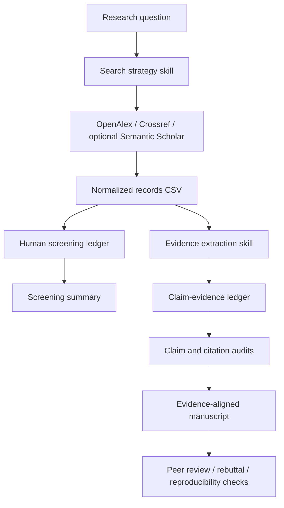

# Architecture

ReasoningAI Studio is a single English-only repository with four layers:

1. **Agent skills (`skills/`)**: 64 standalone workflows. The original 34
   ReasoningAI skills are joined by 30 namespaced `researchforge-*` skills.
   Each skill defines its input, procedure, deliverable, and evidence/integrity
   boundaries.
2. **Prompt pack (`prompts/en/`)**: 12 copy-ready English prompt templates.
3. **Local CLI (`reasoningai/`)**: deterministic Python utilities for OpenAlex
   search, optional Semantic Scholar search, Crossref DOI lookup, BibTeX checks,
   screening-ledger setup, PRISMA-style count summaries, claim-ledger checks,
   SHA-256 manifests, and common secret-pattern scanning.
4. **Research scripts and templates (`scripts/`, `templates/`)**: imported
   ResearchForge tools for dataset audits, bibliography metadata verification,
   skill validation, and heuristic reproducibility preflight, plus reusable
   research protocol, evidence matrix, experiment plan, and claim-evidence
   ledger templates. Their separate CC BY 4.0/MIT licenses are documented in
   `NOTICE.md` and `licenses/`.

No LLM runtime, paid API, proprietary paper database, PDF parser, or hosted
backend is included. The CLI and scripts use Python's standard library. Network
access occurs only when the user explicitly invokes search or DOI verification.

## Data flow

The model interprets and drafts; the local tools validate specific deterministic
structures. Neither replaces researcher judgment, source reading, statistical
expertise, ethics approval, or reproducibility by independent rerun.
